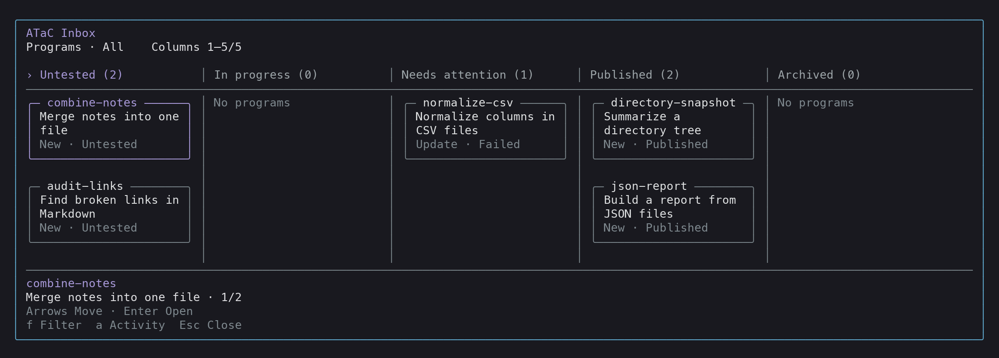

<div align="center">


**Keep what works.**

Turn useful sequences of [pi](https://pi.dev) tool calls into reusable JavaScript programs.

[](https://pi.dev)
[](https://nodejs.org)
[](LICENSE)
[](https://github.com/ATaC-team/ATaC/actions/workflows/ci.yml)

</div>

## Install

Requires Node.js 22.19+ and pi 1.1.x.

```sh
pi install https://github.com/ATaC-team/ATaC
```

Restart pi or run `/reload`, then give pi a task as usual.

## How it works

1. **Work as usual.** ATaC looks for reusable tool-call sequences after pi finishes a task and proposes programs in the background.
2. **Test and publish.** Review candidates in `/atac:inbox`, or enable automatic testing and publishing with `/atac:permissions auto`.
3. **Reuse with new inputs.** pi sees your published programs and is instructed to prefer a matching program over repeating the work.

## Programs

A program combines tool calls with JavaScript logic. This one reads several text files in parallel, joins their contents, and writes a single file:

```javascript
const notes = await Promise.all(
  inputs.paths.map((path) => tools.read({ path })),
);

await tools.write({
  path: inputs.output,
  content: notes.join("\n\n"),
});

return { output: inputs.output };
```

Once published, pi can reuse the whole sequence with a new set of files. Each program includes a manifest and tests; see the [program reference](docs/programs.md) for the format.

## Inbox

Review candidates, inspect code and test reports, request revisions, and browse published programs—all from `/atac:inbox`.



_Inbox with example programs._

Tests call real tools with your existing pi permissions. See the [usage guide](docs/usage.md) for controls and testing behavior.

Manual review is the default. In automatic mode, new candidates are tested when pi is idle and published if they pass, with up to two repairs for program failures. Both modes keep their results in Inbox.

## Documentation

- [Usage](docs/usage.md) — Installation options, Inbox controls, and testing.
- [Programs](docs/programs.md) — Manifests, code, tests, and agent tools.
- [Configuration](docs/configuration.md) — Model settings, execution limits, and local storage.

## Development

Clone the repository and install dependencies, then link the checkout to pi:

```sh
npm ci
pi install /absolute/path/to/ATaC
```

Run checks:

```sh
npm run check
npm test
npm run test:package
```

[Design RFC](https://github.com/ATaC-team/ATaC/issues/4) · [MIT License](LICENSE)
